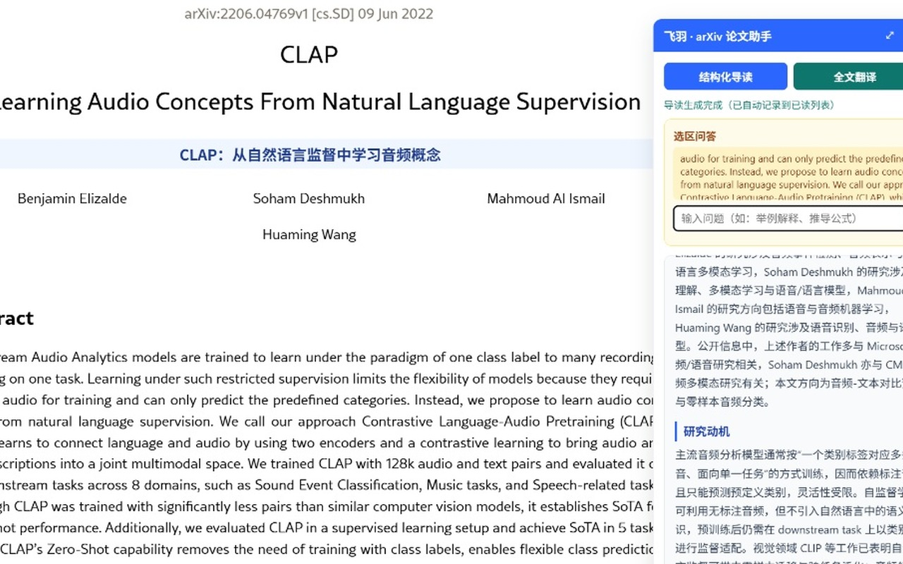
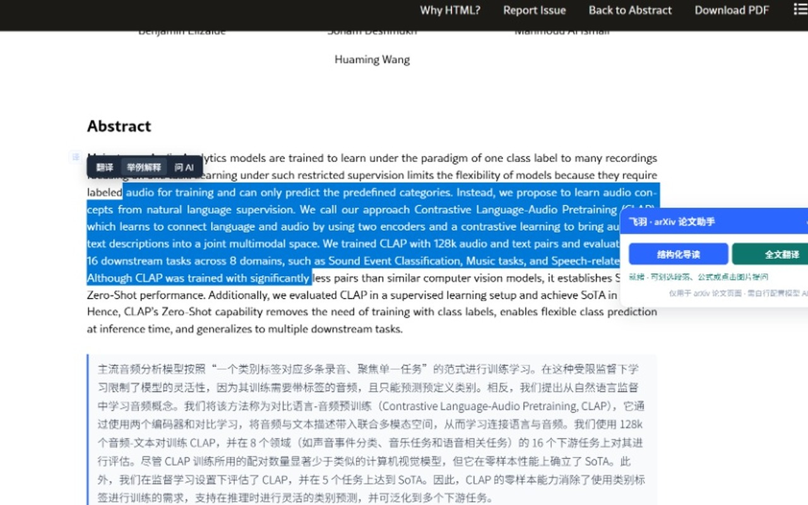
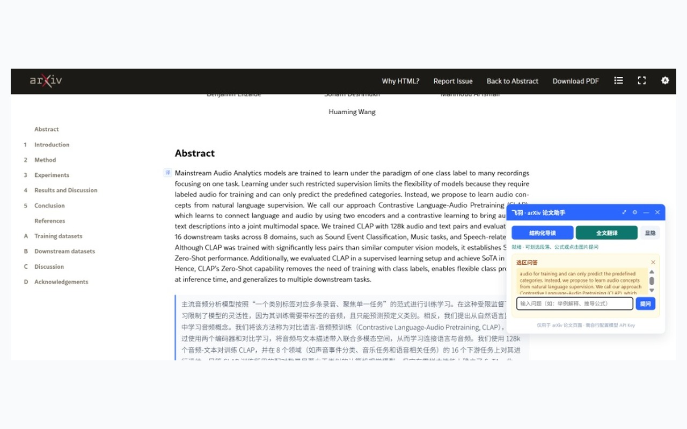

#  飞羽 · arXiv 论文助手

**版本 v2.2.3** · 作者 YangFei

在 arXiv 论文页面生成导读、对照阅读译文，并将阅读记录导出为笔记或文献条目。

## 核心功能

- **结构化导读**：自动识别论文页面中的开源代码仓库链接，梳理作者背景、研究动机、核心方法与实验结果。导读内置常见 LaTeX 公式的渲染支持。
- **双语对照翻译**：支持 arXiv 和 ar5iv 的 HTML 论文全文翻译，也可单独翻译一段。译文随原文展示，翻译前会保护公式节点，译后恢复原有公式。
- **划词与图表问答**：划选段落或公式后，可快速翻译、举例解释或向 AI 提问。点击图表旁的「解释此图」可查看解读，读取图像需要所选模型支持图像输入。
- **阅读记录与 Zotero 导出**：生成导读后自动在本地记录论文和导读。通过扩展弹窗一键导出 Markdown 笔记合集，或导出可直接导入 Zotero 的 BibTeX（`.bib`）文件。

## 效果展示

### 结构化导读



### 双语对照翻译



### 划词与选区问答



### 扩展弹窗与配置


## 安装与使用

### Chrome 应用商店

打开 [Chrome 应用商店的「飞羽 · arXiv 论文助手」详情页](https://chromewebstore.google.com/detail/gmpagaiebchoilchbhdbpgjjbbefipcl)，点击「添加至 Chrome」。

### 本地手动安装

1. 从 [GitHub Releases 下载 `feiyu-arxiv-copilot-v2.2.3.zip`](https://github.com/yangfei-c/feiyu-extensions/releases/download/v2.2.3/feiyu-arxiv-copilot-v2.2.3.zip)并解压。也可以克隆本仓库。

   ```bash
   git clone https://github.com/yangfei-c/feiyu-extensions.git
   ```

2. 在 Chrome 地址栏打开 `chrome://extensions/`。
3. 开启右上角的「开发者模式」。
4. 点击「加载已解压的扩展程序」，选择包含 `manifest.json` 的 `feiyu-arxiv-copilot` 文件夹。

安装后，点击浏览器工具栏中的扩展图标，保存 API 配置，再打开或刷新一篇 arXiv 论文。摘要页可生成导读和翻译摘要，全文翻译请打开 HTML 论文页。生成导读后，可以从扩展弹窗导出阅读记录。

## 配置与隐私

- **适用范围**：扩展的论文页面功能仅作用于 `arxiv.org` 的论文页面和 `ar5iv.labs.arxiv.org` 页面。
- **模型配置**：在扩展弹窗选择 DeepSeek、OpenAI 或「自定义接口」，自行填写 API Key、选择模型，并点击「保存配置」。使用自定义接口时，填写兼容 Chat Completions 的 HTTPS 接口地址，并按浏览器提示授权该地址。
- **本地存储与模型请求**：API Key 与已读论文记录仅保存在当前浏览器的本地存储中。可在扩展弹窗导出或清空已读记录。使用导读、翻译或问答时，扩展会向你配置的模型接口发送本次请求所需的论文内容和提问，并使用 API Key 进行认证。
- **问题反馈**：扩展弹窗提供「问题反馈」入口。仅在你主动点击「发送反馈」时，才向反馈服务提交填写的内容、选填的联系方式、扩展版本，以及浏览器允许读取的当前页面地址。
