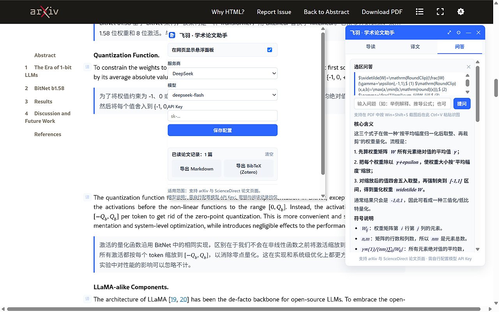

#  飞羽 · 学术论文助手

**版本 v2.3.0** · 作者 YangFei

为科研阅读提供结构化导读、双语对照译文、划词提问与阅读记录导出。

目前已支持 arXiv、ar5iv、ScienceDirect 及 PDF 论文页面，后续将逐步延伸适配更多常见学术论文网站。

## 核心功能

- **三 Tab 分页**：面板分为「导读 / 译文 / 问答」三个页签，各自维护独立的模式与状态栏，切换时互不串台。
- **结构化导读（摘要快读 / 全文精读）**：在「导读」Tab 内可切换两种模式——「摘要快读」仅分析摘要、适合快速筛选论文；「全文精读」读取整篇正文与公式、适合深入拆解方法与实验。导读会识别开源代码仓库、梳理作者背景、研究动机、核心方法与实验结果，并内置常见 LaTeX 公式的渲染支持。
- **双语对照翻译**：支持 arXiv 与 ar5iv 的 HTML 全文、ScienceDirect 的标题 / 摘要 / 正文，以及 PDF 原文。译文逐段显示在原文下方；翻译前保护公式节点、译后恢复。PDF 页支持按页码分段翻译。
- **划词与图表问答**：划选段落或公式后，可快速翻译、举例解释或向 AI 提问。支持在 PDF 页面右键划词，以及在问答输入框内 `Ctrl + V` 粘贴截图，识别图中的公式、表格或图表（需所选模型支持图像输入）。
- **阅读记录与 Zotero 导出**：生成导读后自动在本地记录论文与导读；通过扩展弹窗一键导出 Markdown 笔记合集，或导出可直接导入 Zotero 的 BibTeX（`.bib`）文件。

## 效果展示

### 结构化导读


在 arXiv HTML 论文页生成结构化导读，含核心结论、开源链接与作者背景。

### 双语对照翻译


逐段翻译正文，中文译文显示在原文下方并保留公式。

### 划词与选区问答


划选带公式的段落并点击「举例解释」，AI 结合公式给出解释。

### 扩展弹窗与配置



在扩展弹窗中配置服务商与模型、查看已读记录并导出 Markdown / BibTeX。

## 安装与使用

### Chrome 应用商店

打开 [Chrome 应用商店的「飞羽 · 学术论文助手」详情页](https://chromewebstore.google.com/detail/gmpagaiebchoilchbhdbpgjjbbefipcl)，点击「添加至 Chrome」。

### 本地手动安装

1. 从 [GitHub Releases 下载 `feiyu-arxiv-copilot-v2.3.0.zip`](https://github.com/yangfei-c/feiyu-extensions/releases/download/v2.3.0/feiyu-arxiv-copilot-v2.3.0.zip)并解压。也可以克隆本仓库。

   ```bash
   git clone https://github.com/yangfei-c/feiyu-extensions.git
   ```

2. 在 Chrome 地址栏打开 `chrome://extensions/`。
3. 开启右上角的「开发者模式」。
4. 点击「加载已解压的扩展程序」，选择解压后包含 `manifest.json` 的文件夹。通过仓库克隆安装时，选择 `feiyu-arxiv-copilot` 子目录。

安装后，点击浏览器工具栏中的扩展图标，保存 API 配置，再打开或刷新一篇论文（arXiv / ar5iv / ScienceDirect / PDF）。

## 配置与隐私

- **适用范围**：`arxiv.org` 论文页面、`ar5iv.labs.arxiv.org` 页面、`sciencedirect.com` 论文页面（`/science/article/*`），以及这些站点上的 PDF 原文页。
- **BYOK 自带密钥**：需自行在扩展弹窗选择 DeepSeek、OpenAI 或「自定义接口」，并填写自己的 API Key、选择模型；使用自定义接口时填写兼容 Chat Completions 的 HTTPS 地址并按提示授权。
- **本地存储**：API Key 与已读论文记录仅保存在当前浏览器的 `chrome.storage.local` 中，不上传第三方服务器。
- **模型请求**：仅在用户主动触发导读、翻译或问答时，才把本次请求所需的论文内容与提问发送到用户配置的模型接口，并使用 API Key 完成认证。
- **问题反馈**：扩展弹窗提供「问题反馈」入口，仅在你主动点击「发送反馈」时提交填写内容、选填联系方式、扩展版本与当前页面地址。
