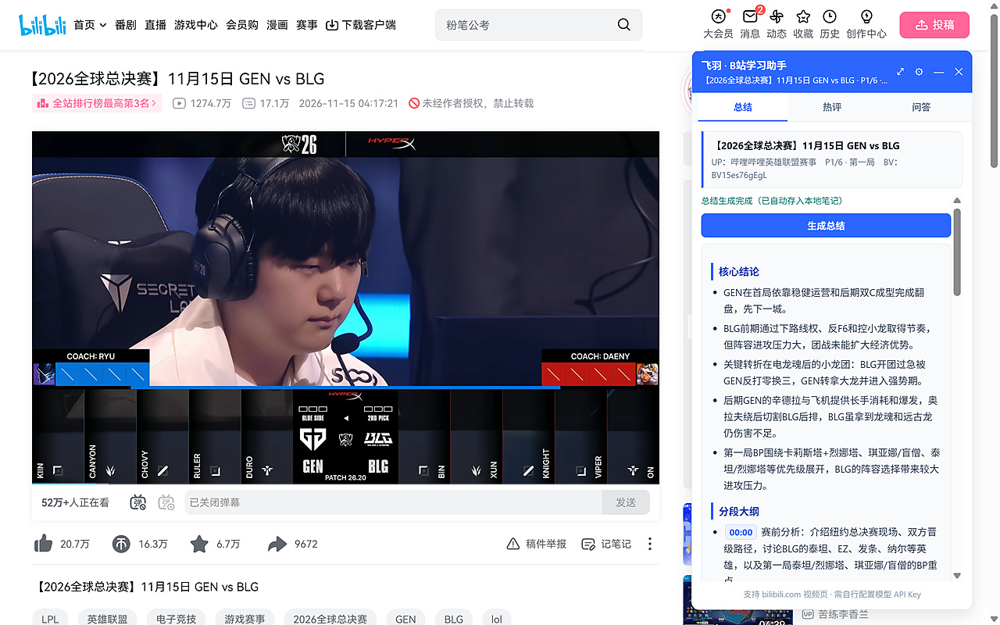
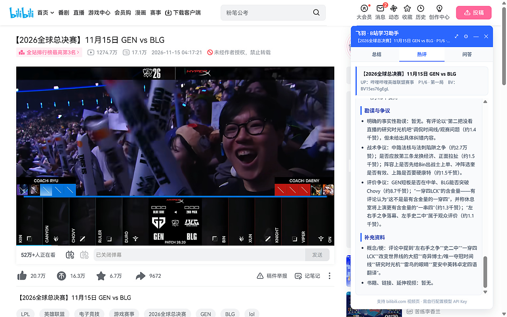

#  飞羽 · B站学习助手

**版本 v1.0.0** · 作者 YangFei

在 B 站视频播放页读取字幕，生成带时间戳的 AI 学习笔记，提炼高赞热评，并支持就视频内容随时提问。

## 核心功能

- **带时间戳的 AI 总结**：读取视频 AI 字幕，按「核心结论 / 分段大纲 / 关键知识点」输出学习笔记。每条大纲与知识点都附带可点击的 `[MM:SS]` 时间戳，点击即可跳转到播放器对应位置继续播放。总结会一并参考视频简介（常含课程目录、仓库链接与勘误）与 B 站官方章节，长网课字幕上限放宽到 6 万字符，避免后段内容被截断。
- **高赞热评与 AI 课代表提炼**：拉取按热度排序的前排高赞评论，并提供「AI 提炼课代表笔记」，整理课代表总结、勘误争议与补充资料。
- **视频问答**：以当前视频字幕（或弹幕概览）为上下文回答提问；在问答输入框内按 `Ctrl + V` 可直接粘贴视频里的 PPT、代码或公式截图，随问题一起发送给支持视觉的模型。
- **字幕不可用时的弹幕兜底**：未登录 B 站或该视频没有 AI 字幕时，面板会给出清晰提示，并支持改用弹幕按时间聚合生成概览。
- **原文字幕查看与复制**：在「总结」区可一键展开带可点击时间戳的原始字幕列表，并支持一键复制全部字幕文本。
- **SPA 自动跟随与笔记导出**：B 站切换推荐视频或切换分 P 不会整页刷新，面板会监听地址变化、清空上一视频状态并重建；每次生成总结自动按「视频 + 分 P」存入本地（最多 200 条），可在扩展弹窗批量导出 `.md`。

## 效果展示

### 带时间戳的视频总结



在 B 站视频页生成带时间戳的结构化总结，大纲与知识点可点击跳转到对应播放位置。

### 高赞热评与 AI 课代表提炼



拉取高赞评论并由 AI 提炼出课代表笔记，归纳争议、勘误与补充资料。

## 安装与使用

### 本地手动安装

1. 下载并解压本目录，或克隆本仓库：

   ```bash
   git clone https://github.com/yangfei-c/feiyu-extensions.git
   ```

2. 在 Chrome 地址栏打开 `chrome://extensions/`。
3. 开启右上角的「开发者模式」。
4. 点击「加载已解压的扩展程序」，选择包含 `manifest.json` 的 `feiyu-bilibili-copilot` 文件夹。
5. 打开任意 B 站视频播放页（`https://www.bilibili.com/video/*`），页面右侧会出现悬浮面板；若未出现，点击工具栏扩展图标并勾选「在网页显示悬浮面板」。

安装后，先点击扩展图标配置服务商、模型与 API Key，再回到视频页生成总结。

### 使用步骤

1. 在 B 站右上角登录账号（AI 字幕需要登录态才能读取；未登录时会提示改用弹幕）。
2. 打开视频播放页，等待面板识别出标题、UP 主与分 P 信息。
3. 切换到「总结」页，点击「生成总结」；也可在「热评」页拉取评论并提炼，或到「问答」页直接提问。
4. 面板右上角 `⤢` 可在紧凑浮窗与全高侧边栏之间切换；`⚙` 打开模型设置，`—` 折叠，`✕` 隐藏。
5. 生成过的总结会存入本地笔记，可在扩展弹窗中导出 Markdown。

## 配置与隐私

- **适用范围**：仅在 `bilibili.com` 的视频播放页（`/video/*`）注入，普通视频页与多分 P 视频页均支持。
- **BYOK 自带密钥**：在扩展弹窗选择 DeepSeek、OpenAI 或「自定义接口」，并填写自己的 API Key、选择模型；使用自定义接口时填写兼容 Chat Completions 的 HTTPS 地址并按提示授权。
- **B 站登录态**：扩展会以你的登录 Cookie 请求 B 站自身的 `api.bilibili.com` 接口（播放器信息、字幕、评论）与 `aisubtitle.hdslb.com` 字幕 JSON，仅用于读取当前视频的字幕与评论，不会上传 Cookie。
- **本地存储**：API Key 与视频笔记仅保存在当前浏览器的 `chrome.storage.local` 中，可随时清空或导出。
- **模型请求**：仅在用户主动触发总结、热评提炼或问答时，才把本次请求所需的字幕 / 评论文本与提问发送到用户配置的模型接口，并使用 API Key 完成认证。
- **问题反馈**：扩展弹窗提供「问题反馈」入口，仅在你主动点击「发送反馈」时提交填写内容、选填联系方式、扩展版本与当前页面地址。

## 开发说明

- 使用 Chrome Manifest V3，原生 JS，零打包。
- **取数方式**：元数据、播放器信息、热评都由内容脚本在 `www.bilibili.com` 页面上下文直接 `fetch(..., { credentials: 'include' })` 请求 `api.bilibili.com`；只有 `subtitle_url` 指向的 `aisubtitle.hdslb.com` 字幕 JSON 因跨域限制改经 `service-worker.js` 代理，且拿到链接后立即下载（URL 中的 `auth_key` 有时效）。
- **播放器信息端点**：使用 B 站播放器同款 `/x/player/wbi/v2?bvid=<bvid>&cid=<cid>`。旧端点 `/x/player/v2` 已废弃——它对 `cid` 不做校验，会静默返回其它视频的字幕 URL。
- **视频身份以地址为准**：每次获取元数据、字幕或评论前，都重新从 `location.pathname` 解析 `bvid`、从 `location.search` 解析 `p`（默认 1），再请求 `x/web-interface/view`，由该接口返回的 `aid` / `title` / `owner.name` / `pages` 作为唯一权威数据源；当前分 P 的 `cid` 只从本次返回的 `pages` 中按 `page === p` 取。
- **防串台四道闸**：① 接口回显 `cid`/`aid`/`bvid` 与请求不一致立即中止；② 字幕缓存按 `bvid|p|cid` 绑定，不跨视频复用；③ 校验 `subtitle_url` 是否指向其它已知视频（`ai-zh` 地址形如 `.../ai_subtitle/prod/<aid><cid><hash>`，只认前缀型强证据）；④ 字幕末条时间超过视频时长 +60s 判定为异常并拒绝使用。
- **字幕筛选**：优先 UP 主投稿中文字幕（`lan` 为 `zh-CN`/`zh-Hans` 且 `ai_type === 0`），其次 `ai-zh`；若所有条目的 `subtitle_url` 为空，提示「该视频字幕正在生成中或暂无可用字幕」。
- **官方章节**：`/x/player/wbi/v2` 返回的 `data.view_points[]`（`from`/`to`/`content`）与 `x/web-interface/view` 的 `data.desc`（视频简介）一并交给 AI，用于对齐分段大纲与补充课程目录 / 仓库链接 / 勘误信息。
- **界面状态**：「总结」「热评」「问答」三个 Tab 各自维护状态栏，切换 Tab 不会串台；排查信息默认折叠为一行小字，点击才展开。
- **截图问答**：问答输入框监听 `paste` 事件，读取剪贴板图片转 dataURL，经后台以 `image_url` 多模态消息发送；所选模型不支持视觉时自动回退到 `deepseek-flash`。
- `src/content/page-bridge.js` 以 `world: "MAIN"` 注入页面主世界，但只作为「页面状态 / 地址变化」的探测器，通过 `postMessage` 通知隔离世界重新解析；它不传递也不代表任何权威元数据。
- 多集 / 合集视频切换时，页面 `__INITIAL_STATE__` 会残留上一集数据，因此**禁止**用它决定当前 `cid`（`videoData.cid` 在多 P 下还固定为 P1）。切换视频或分 P 时会立即清空面板与字幕 / 评论缓存，并在面板标题栏显示最新抓取到的标题与 BV 号。
